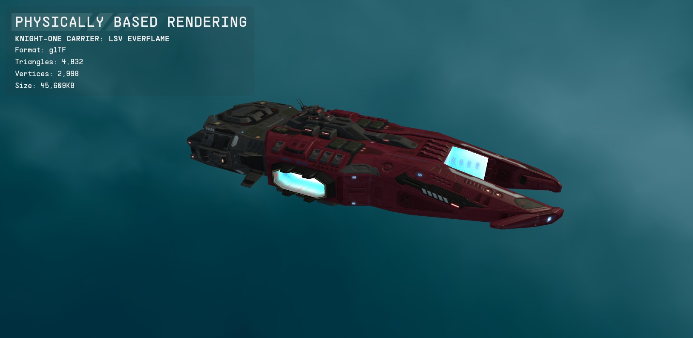

# Pandora

> [!WARNING]
> Please note that this engine is used for the development of personal projects and not intended for general use.

A C++20 game engine framework built on WebGPU, supporting both native (Windows, Linux) and web (Emscripten) targets.

## Features

- **WebGPU Rendering** - Modern graphics API via Dawn (native) or browser WebGPU (web)
- **Cross-Platform** - Builds for Windows, Linux and WebAssembly
- **ImGui Integration** - Immediate mode UI with FreeType font rendering
- **Bullet Physics** - 3D physics simulation
- **Entity Component System** - Using EnTT
- **Virtual File System** - Abstracted file access for native and web builds
- **Resource Management** - Asynchronous resource loading
- **Scene Management** - Scene graph with update loop
- **Debug Rendering** - Debug visualization tools
- **Input System** - Keyboard and mouse input handling

## Dependencies

- GLFW (windowing)
- GLM (math)
- ImGui (UI)
- Bullet3 (physics)
- EnTT (ECS)
- FreeType (fonts)
- nlohmann/json (JSON parsing)
- stb (image loading)
- tinygltf (glTF loading)

## License

*Pandora* is licensed under the GPLv3 License, see [LICENSE](LICENSE) for more information.